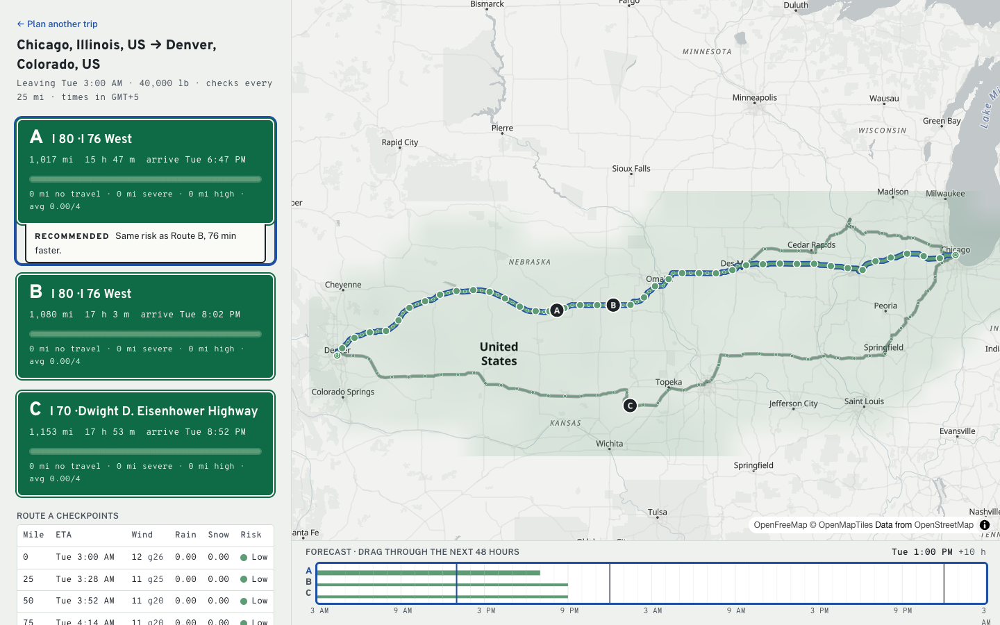

# Weather-aware truck routing

A truck driver enters a start, a destination, a departure time and a load weight. The app plans three truck routes, checks the forecast at each checkpoint for the hour the truck will be there, scores the risk using the brief's wind, rain, snow and load rules, and recommends the safest route. The map shows every route, checkpoint and risk stretch, plus a 0–48 hour weather-risk heatmap over the trip corridor that you scrub with a logbook-style timeline.



Hosted: _added after deploy_

## Run locally

Requirements: Python 3.13+ with [uv](https://docs.astral.sh/uv/), and [bun](https://bun.sh). No API keys are needed.

```bash
# API on http://127.0.0.1:8000
cd backend
uv sync
uv run python manage.py migrate
uv run python manage.py runserver

# Web app on http://localhost:5173 (proxies /api to the API)
cd frontend
bun install
bun run dev
```

Tests and checks:

```bash
cd backend && uv run pytest && uv run ruff check .
cd frontend && bun run test && bun run check
```

## How a trip is planned

1. **Place search.** [Photon](https://photon.komoot.io) (OpenStreetMap) suggests places as you type, limited to North America.
2. **Routes.** [Valhalla](https://valhalla1.openstreetmap.de)'s public `truck` profile returns the fastest route and its alternates, using the load weight in tonnes. If that gives fewer than 3, the app asks for detours through points on either side of the trip's midpoint (15% and 30% of the trip length out). A detour is kept only if it takes at most 1.6× as long as the fastest route and less than 80% of it overlaps the routes already found. If 3 different routes still don't exist, the trip says so.
3. **Checkpoints.** There is one checkpoint at the origin, then one every 10, 25 or 50 miles (you choose), plus one at the destination. A checkpoint's ETA is departure time plus Valhalla's drive time to that mile. Valhalla gives a time for each maneuver; the app spreads it along that maneuver's path by distance.
4. **Forecast at each ETA.** Each checkpoint gets [Open-Meteo](https://open-meteo.com)'s hourly forecast for its location, in mph and inches. All locations in a trip are fetched together, 50 per request.
5. **Risk.** Each checkpoint gets a risk level from the rules below.
6. **Route totals.** The stretch between two checkpoints takes the worse level of its two ends. Each route then adds up its miles at each level and a distance-weighted average risk from 0 to 4.
7. **Ranking.** Routes are ordered by fewest No Travel miles, then fewest Severe miles, then fewest High miles, then lowest average risk, then shortest drive time. The recommendation explains in one line which of these decided it.
8. **Saving.** The trip is stored in SQLite and gets its own URL (`/trips/<id>?route=B`).
9. **Heatmap.** When the map asks for it, the app builds a grid of roughly 20-mile cells within 40 miles of the routes (at most 250 cells), scores each cell for each of the 49 hours from departure, and caches the result on the trip. The browser blends neighbouring hours as you drag the timeline.

## Risk rules as implemented

| Condition | Low | Moderate | High | Severe | No Travel |
|---|---|---|---|---|---|
| Wind (mph) | < 25 | 25 – < 35 | 35 – < 45 | 45 – < 55 | ≥ 55 |
| Rain (in/hr) | < 0.10 | 0.10 – < 0.25 | 0.25 – < 0.50 | 0.50 – 1.00 | > 1.00 |
| Snow (in/hr) | < 0.5 | 0.5 – < 1.0 | 1.0 – < 2.0 | 2.0 – 3.0 | > 3.0 |

- **Band edges.** A value exactly on a band edge belongs to the higher band (25 mph is Moderate, 0.25 in/hr rain is High). The top band follows the brief's symbols: wind ≥ 55 is No Travel, but rain and snow must be *more than* 1.00 and 3.0.
- **Load rules.** These apply to wind only. Wind 45–54 mph with more than 30,000 lb is No Travel. Wind 35–44 mph with more than 40,000 lb is Severe. "More than" is strict, so exactly 30,000 lb or 40,000 lb doesn't trigger them. Wind ≥ 55 is No Travel for every load. The checkpoint table marks levels raised by the load with "+ load".
- **Overall level.** A checkpoint's level is the worst of its wind (after load rules), rain and snow. Every condition at that worst level is listed as a cause.
- **Wind** means sustained wind at 10 m. Gusts are shown but not scored.
- **Rain** means Open-Meteo's `rain + showers`. **Snow** means `snowfall`, already in inches.
- **Timing.** Open-Meteo's rain and snow values are totals for the hour *ending* at each timestamp, so a checkpoint uses the hour that contains its ETA. Wind is blended linearly between the two surrounding hours.
- **Ranking.** No Travel miles are ranked before Severe miles, because No Travel is worse; the brief's list starts at Severe. If every route crosses No Travel, the least-bad one is still ranked first and a banner suggests leaving later.

## Assumptions and limits

- ETAs follow Valhalla's truck drive times with no hours-of-service breaks, fuel stops or traffic.
- Valhalla, Open-Meteo and Photon are free public servers with fair-use limits and no uptime guarantee. If one is down or slow, the API returns a 502 with a plain message and the form stays usable.
- Valhalla's public server won't route trips longer than about 930 miles in a straight line (1,500 km). The app explains this instead of failing.
- Open-Meteo's free tier allows about 600 locations a minute. To stay under it, forecasts are snapped to a 0.1° grid (about 7 miles) and cached for 1 hour, and the heatmap is limited to 250 cells and cached per trip.
- Departures must be between 1 hour ago and 7 days ahead. A trip whose later checkpoints fall beyond the forecast is rejected with a message asking for an earlier departure.
- The API speaks UTC ISO-8601. The UI shows times in the browser's time zone.

## Code map

```
backend/
  config/            settings, urls (API + SPA fallback), views.spa
  trips/
    engine/          pure rules, no Django or network imports
      risk.py          bands, load rules, Assessment
      forecast.py      HourlySeries, conditions_at (ETA → conditions)
      checkpoints.py   checkpoint miles, ETAs, path thinning and slicing
      scoring.py       segment levels, route summaries, recommend()
      corridor.py      heatmap grid and 49 hourly frames
      geo.py, route.py
    providers/       valhalla.py, open_meteo.py (+ SQLite cache), photon.py
    services.py      plan_trip(), build_corridor(): orchestration only
    api.py           /api/health, /geocode, /trips, /trips/{id}, /trips/{id}/corridor
frontend/src/
  routes/            __root (panel + persistent map), index (plan form), trips.$tripId
  api/               types, fetch client, React Query options
  features/
    planner/         TripForm, PlaceInput (combobox), validate
    routes/          RouteSign (guide sign), RiskStrip, CheckpointTable
    map/             TripMap, CorridorLayer (canvas raster), layers, geojson
    logbook/         LogbookScrubber (0–48 h timeline)
    stage/           TripStage (map + logbook, keeps the map mounted)
  lib/               risk palette, formatting, timeline math
```

## Deploy

The app ships as one container: Django serves the API and the built SPA, with WhiteNoise serving the assets.

```bash
docker build -t truck-routing .
docker run --rm -p 8000:8000 -e DJANGO_ALLOWED_HOSTS=localhost truck-routing
```

On Render, push the repo to GitHub, then go to **New → Blueprint**, pick the repo, and Render creates the service from `render.yaml`. Set `HTTP_USER_AGENT` to `WeatherAwareTruckRouting/1.0 (+<your repo URL>)` so the public services can identify the app. On the free plan SQLite is wiped on every redeploy, so saved trips don't survive one.
